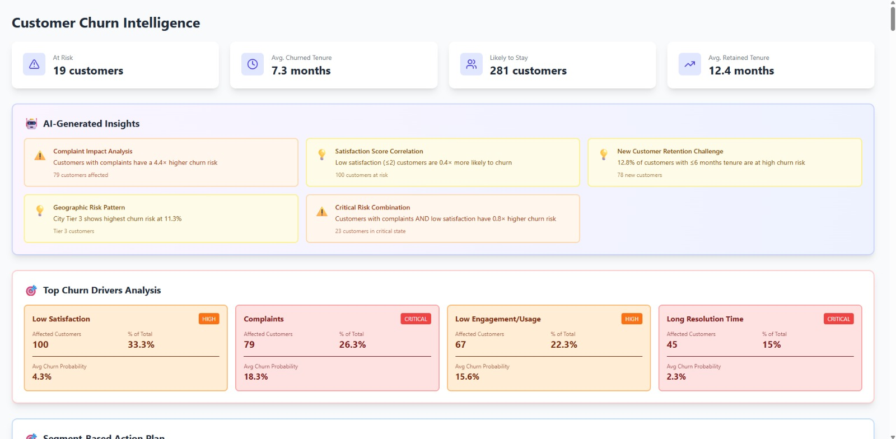
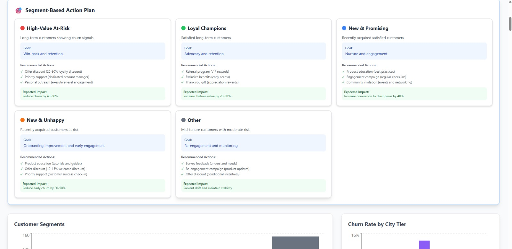
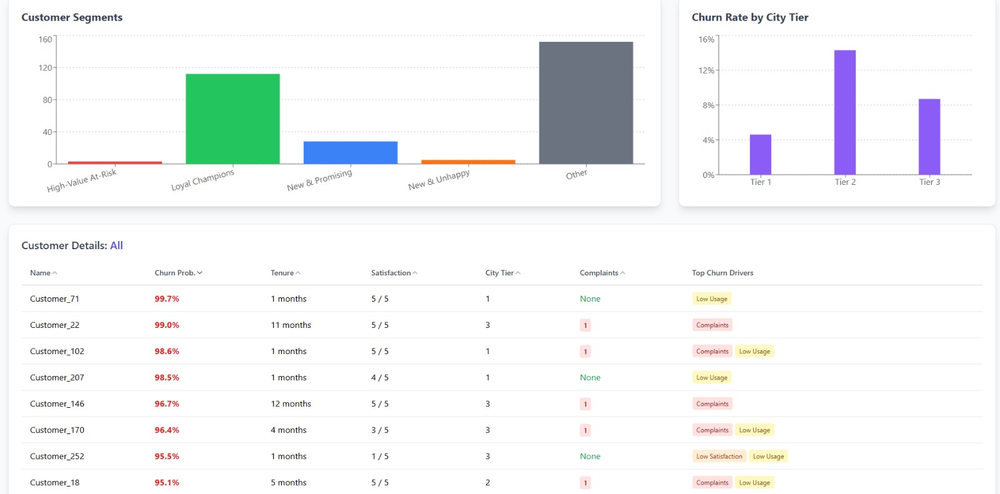

# 🌀 Customer Churn Prediction Dashboard

A full-stack **Customer Churn Prediction and Analytics Dashboard** that uses machine learning to identify customers at risk of leaving, visualize churn patterns, and support data-driven customer retention strategies.

The application combines a **Flask backend** with a **React and TypeScript frontend**, providing CSV-based bulk predictions, customer segmentation, churn analytics, and actionable retention recommendations.

---

## 📸 Screenshots

### 1. Customer Churn Intelligence Dashboard

The main dashboard displays customer risk indicators, churn statistics, AI-generated insights, and the leading factors associated with customer churn.



### 2. Customer Segmentation and Retention Strategies

Customers are grouped into actionable segments, with recommended retention strategies tailored to their engagement, satisfaction, and churn risk.



### 3. Customer Analytics and Churn Visualization

Explore customer-level prediction results, compare churn rates across city tiers, and analyze customer segments using interactive charts and detailed tables.



---

## 🚀 Features

### 📁 CSV-Based Data Upload
- Upload customer datasets in CSV format for bulk churn prediction.
- Process customer records using Pandas.
- Prepare customer features for model inference.
- Store prediction results for further analysis.

### 🤖 Machine Learning-Based Churn Prediction
- Uses a trained **XGBoost classification model** to estimate customer churn probability.
- Identifies customers who may require retention interventions.
- Generates prediction scores for individual customer records.

### 📊 Interactive Analytics Dashboard
- Displays key customer and churn metrics.
- Visualizes customer distribution across segments.
- Compares churn rates by city tier.
- Highlights customer complaints and other churn-related factors.
- Presents customer-level prediction results.

### 👥 Intelligent Customer Segmentation

Organizes customers into actionable groups:

- **High-Value At-Risk:** Long-term or valuable customers exhibiting churn signals.
- **Loyal Champions:** Satisfied customers with strong retention potential.
- **New & Promising:** Recently acquired customers showing positive engagement.
- **New & Unhappy:** New customers exhibiting dissatisfaction or early churn signals.
- **Other:** Customers requiring continued monitoring or additional engagement.

### 💡 AI-Generated Insights
- Summarizes important churn patterns and customer risk indicators.
- Highlights relationships between customer characteristics and churn.
- Helps identify customer groups that may benefit from targeted retention efforts.

### 🎯 Retention Action Recommendations
- Suggests targeted retention strategies for different customer segments.
- Supports customer engagement, onboarding improvements, and loyalty initiatives.
- Helps prioritize customers for retention campaigns.

### 🔍 Customer-Level Analysis
- Displays churn probability, tenure, satisfaction scores, and city tier.
- Highlights complaints and potential churn drivers.
- Supports detailed analysis of individual customer records.

---

## 🛠️ Tech Stack

### Backend
- Python
- Flask
- Pandas
- Scikit-learn
- XGBoost
- Flask-CORS
- SQLite

### Frontend
- React.js
- TypeScript
- Vite
- Axios
- Tailwind CSS
- Recharts
- Lucide React

### Machine Learning
- XGBoost classification
- Customer churn probability prediction
- Feature preprocessing
- Customer segmentation and churn analytics

---

## 📂 Project Structure

```text
customer-churn-prediction/
│
├── backend/
│   ├── app.py
│   ├── churn_prediction_model.pkl
│   ├── columns.json
│   ├── requirements.txt
│   └── customers.db
│
├── frontend/
│   ├── public/
│   ├── src/
│   ├── package.json
│   ├── package-lock.json
│   └── vite.config.ts
│
├── screenshots/
│   ├── dashboard-overview.png
│   ├── customer-segments.png
│   └── customer-details.png
│
├── .gitignore
└── README.md
```

*Note: The structure above is illustrative. Adjust it to match your actual project files. Do not upload your virtual environment or `node_modules` folder.*

---

## ⚙️ Setup and Installation

### Prerequisites

Install the following before running the application:

- Python 3.11
- Node.js and npm
- Git

### 1. Clone the Repository

```bash
git clone https://github.com/YOUR_USERNAME/customer-churn-prediction.git
cd customer-churn-prediction
```

Replace `YOUR_USERNAME` with your GitHub username.

### 2. Set Up the Backend

Navigate to the backend directory:

```bash
cd backend
```

Create a Python virtual environment:

```bash
python -m venv venv
```

Activate the environment on Windows:

```powershell
.\venv\Scripts\Activate.ps1
```

On macOS or Linux:

```bash
source venv/bin/activate
```

Install the backend dependencies:

```bash
pip install -r requirements.txt
```

**Important:** Use compatible package versions for the trained model. If the model was saved using specific versions of XGBoost, Scikit-learn, NumPy, or Pandas, use compatible versions when loading it.

Ensure the trained model file, `churn_prediction_model.pkl`, and any required configuration files are present in the backend directory.

### 3. Run the Backend

Start the Flask application:

```bash
python app.py
```

The backend should be available at:

```text
http://127.0.0.1:5000
```

Keep the backend terminal running while using the frontend.

### 4. Set Up the Frontend

Open a second terminal and navigate to the frontend directory from the project root:

```bash
cd frontend
```

Install the frontend dependencies:

```bash
npm install
```

Start the development server:

```bash
npm run dev
```

The frontend should be available at:

```text
http://localhost:5173
```

*The backend and frontend addresses above assume your application uses these default ports.*

---

## 🧑‍💻 How to Use

1. Start the Flask backend.
2. Start the React frontend.
3. Open the frontend in your browser.
4. Upload a CSV file containing customer data.
5. Allow the backend to process the uploaded records.
6. Review the generated churn probabilities and customer risk indicators.
7. Explore customer segments, analytics charts, and retention recommendations.
8. Use the dashboard insights to identify customers who may benefit from targeted retention efforts.

### CSV Input Requirements

The uploaded CSV must contain the feature columns expected by the trained model.

Ensure that:
- Column names match the model's expected input features.
- Each feature is stored in its own CSV column.
- Numeric features contain valid numeric values.
- Categorical features are encoded consistently with the training process.
- The target column `churn` is excluded from prediction input unless your application explicitly expects it.

**Important:** Use the same feature preprocessing and column order as the training pipeline. A CSV with incompatible columns may cause prediction errors.

---

## 🔌 API Endpoints

The application exposes the following endpoints, based on the implemented backend functionality:

| Method | Endpoint | Description |
|---|---|---|
| `POST` | `/upload` | Upload a CSV file, generate predictions, and save results. |
| `GET` | `/customers` | Retrieve customer records and prediction results. |
| `GET` | `/stats` | Retrieve dashboard statistics and key performance indicators. |
| `GET` | `/segments` | Retrieve customer segment statistics. |

*These endpoints should match the routes implemented in `backend/app.py`. Update this table if your actual route names differ.*

---

## 🧠 Machine Learning Workflow

The application follows a typical machine learning inference workflow:

1. **Data ingestion:** Accept customer data through CSV uploads.
2. **Preprocessing:** Prepare input features in the format expected by the trained model.
3. **Prediction:** Use the trained XGBoost classifier to estimate churn probabilities.
4. **Storage:** Persist customer information and prediction results in SQLite.
5. **Analytics:** Aggregate prediction results to generate customer-level and segment-level insights.
6. **Retention planning:** Present risk indicators and recommended actions through the dashboard.

---

## 🔐 Data and Model Considerations

- Do not upload confidential customer information or personally identifiable data.
- Exclude virtual environments, dependency folders, and secret configuration files from version control.
- Only load trusted model files because Python pickle files can execute code during deserialization.
- Ensure that the model and inference dependencies are compatible.
- Treat churn predictions as estimates rather than guarantees of future customer behavior.

---

## 🔮 Future Improvements

Potential enhancements include:

- Deploying the frontend and backend to cloud hosting platforms.
- Adding authentication and role-based access control.
- Improving model explainability using feature importance or SHAP.
- Introducing automated model evaluation and retraining.
- Adding downloadable prediction reports.
- Implementing monitoring for prediction quality and data drift.

---

## 🤝 Contributing

Contributions, suggestions, and improvements are welcome.

1. Fork the repository.
2. Create a feature branch.
3. Implement your changes.
4. Submit a pull request.

---

## 📄 License

Choose an appropriate open-source license if you want others to reuse your code. For example, you can use the MIT License by adding a `LICENSE` file containing its terms.

---

## 👨‍💻 Author

Developed as a machine learning and full-stack development project focused on customer churn analysis and retention insights.

For questions, suggestions, or feedback, please open an issue in this repository.